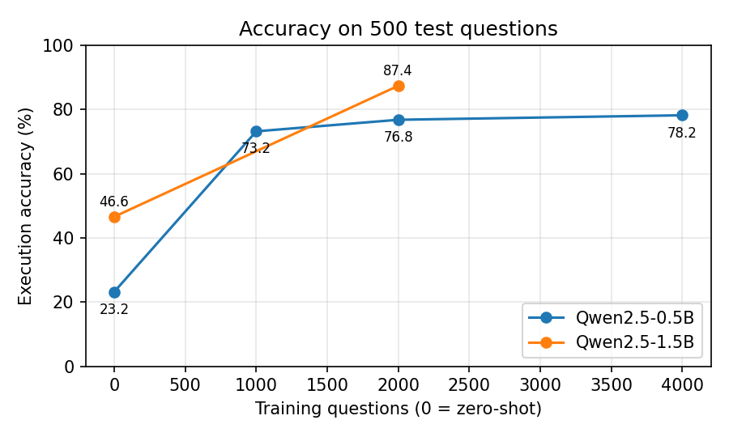

# Results on the evaluation set

500 questions from the WikiSQL test split (tables never seen in training). Execution accuracy: the query returns the same result as the true query. Runs: the query executes without error.

| Run | Model | Execution accuracy | Exact match | Runs | No aggregation | Aggregation | 2+ conditions | s/question |
|---|---|---|---|---|---|---|---|---|
| qwen2.5-0.5b | Qwen2.5-0.5B-Instruct-4bit | **23.2%** | 14.2% | 46.2% | 24.0% | 20.9% | 18.5% | 0.525 |
| qwen2.5-1.5b | Qwen2.5-1.5B-Instruct-4bit | **46.6%** | 34.6% | 63.0% | 50.9% | 34.1% | 41.9% | 1.602 |
| qwen2.5-0.5b-lora-2k-r16 | Qwen2.5-0.5B-Instruct-4bit + LoRA | **72.8%** | 63.6% | 96.0% | 76.3% | 62.8% | 66.1% | 0.403 |
| qwen2.5-0.5b-lora-1k | Qwen2.5-0.5B-Instruct-4bit + LoRA | **73.2%** | 65.6% | 96.8% | 77.6% | 60.5% | 72.6% | 0.514 |
| qwen2.5-0.5b-lora-2k | Qwen2.5-0.5B-Instruct-4bit + LoRA | **76.8%** | 68.4% | 98.0% | 79.2% | 69.8% | 78.2% | 0.506 |
| qwen2.5-0.5b-lora | Qwen2.5-0.5B-Instruct-4bit + LoRA | **78.2%** | 70.4% | 99.0% | 82.8% | 65.1% | 77.4% | 0.374 |
| qwen2.5-0.5b-lora-2k-r4 | Qwen2.5-0.5B-Instruct-4bit + LoRA | **80.8%** | 72.8% | 99.0% | 83.8% | 72.1% | 81.4% | 0.325 |
| qwen2.5-1.5b-lora-2k | Qwen2.5-1.5B-Instruct-4bit + LoRA | **87.4%** | 78.2% | 99.8% | 89.5% | 81.4% | 87.9% | 0.967 |

## Where the wrong answers come from (share of all questions)

| Run | unknown column | syntax error | wrong SELECT | wrong WHERE | both wrong | other |
|---|---|---|---|---|---|---|
| qwen2.5-0.5b | 25.4% | 23.4% | 3.4% | 11.2% | 5.2% | 8.2% |
| qwen2.5-1.5b | 14.4% | 19.2% | 3.6% | 6.6% | 4.8% | 4.8% |
| qwen2.5-0.5b-lora-2k-r16 | 3.2% | 0.4% | 5.4% | 12.8% | 4.8% | 0.6% |
| qwen2.5-0.5b-lora-1k | 2.8% | 0.4% | 5.0% | 14.2% | 4.4% | 0.0% |
| qwen2.5-0.5b-lora-2k | 1.6% | 0.4% | 5.6% | 12.4% | 3.2% | 0.0% |
| qwen2.5-0.5b-lora | 0.8% | 0.0% | 5.6% | 11.6% | 3.6% | 0.2% |
| qwen2.5-0.5b-lora-2k-r4 | 1.0% | 0.0% | 5.2% | 9.8% | 3.2% | 0.0% |
| qwen2.5-1.5b-lora-2k | 0.0% | 0.0% | 5.0% | 4.6% | 2.8% | 0.2% |

## Fine-tuning runs

Same settings unless listed (see params.yaml): QLoRA on all layers, batch 2 with 2 steps of gradient accumulation, peak learning rate 5e-5, one pass over the questions shown. One run per setting: with 500 questions, an accuracy near 80 % has a 95 % interval of about ±3.5 points, so smaller differences are not reliable. Training times depend on what else the laptop was doing.

| Run | Model | Training questions | Rank | Trainable parameters | Training time | Peak memory | Validation loss | Execution accuracy |
|---|---|---|---|---|---|---|---|---|
| qwen2.5-0.5b-lora-1k | Qwen2.5-0.5B-Instruct-4bit | 1,000 | 8 | 4.4 M | 22 min | 2.2 GB | 0.088 | **73.2%** |
| qwen2.5-0.5b-lora-2k-r4 | Qwen2.5-0.5B-Instruct-4bit | 2,000 | 4 | 2.2 M | 41 min | 2.1 GB | 0.079 | **80.8%** |
| qwen2.5-0.5b-lora-2k | Qwen2.5-0.5B-Instruct-4bit | 2,000 | 8 | 4.4 M | 41 min | 2.2 GB | 0.078 | **76.8%** |
| qwen2.5-0.5b-lora-2k-r16 | Qwen2.5-0.5B-Instruct-4bit | 2,000 | 16 | 8.8 M | 30 min | 2.2 GB | 0.091 | **72.8%** |
| qwen2.5-0.5b-lora | Qwen2.5-0.5B-Instruct-4bit | 4,000 | 8 | 4.4 M | 62 min | 2.2 GB | 0.075 | **78.2%** |
| qwen2.5-1.5b-lora-2k | Qwen2.5-1.5B-Instruct-4bit | 2,000 | 8 | 9.2 M | 172 min | 4.1 GB | 0.059 | **87.4%** |

